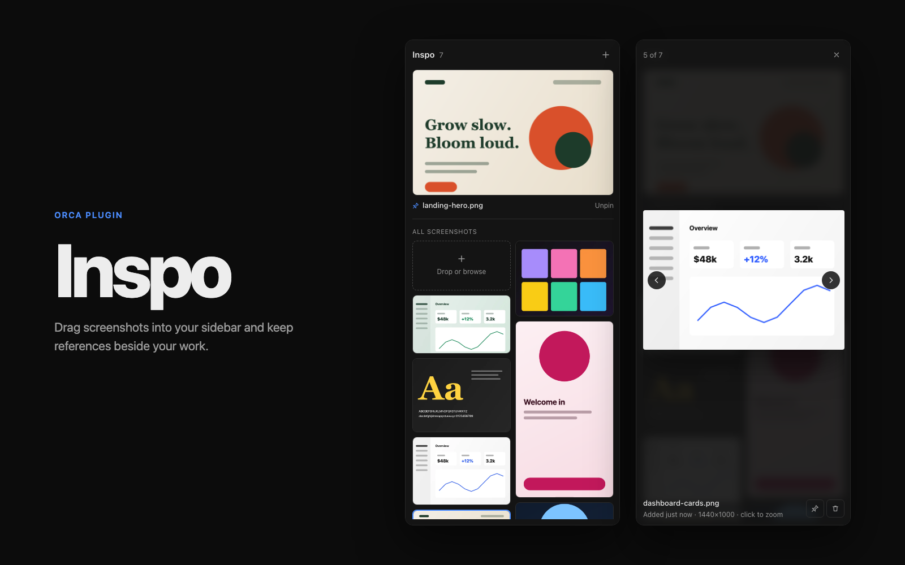
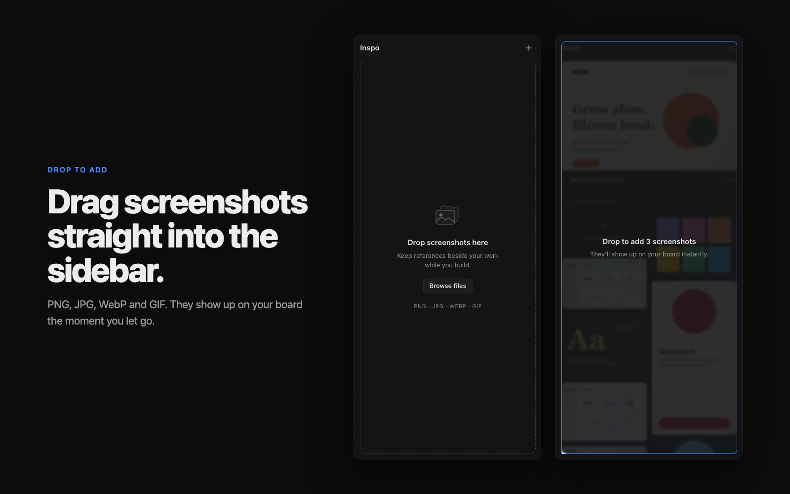
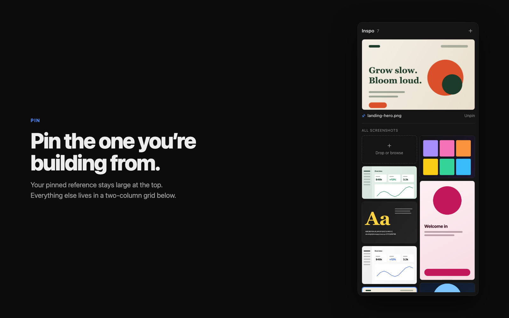
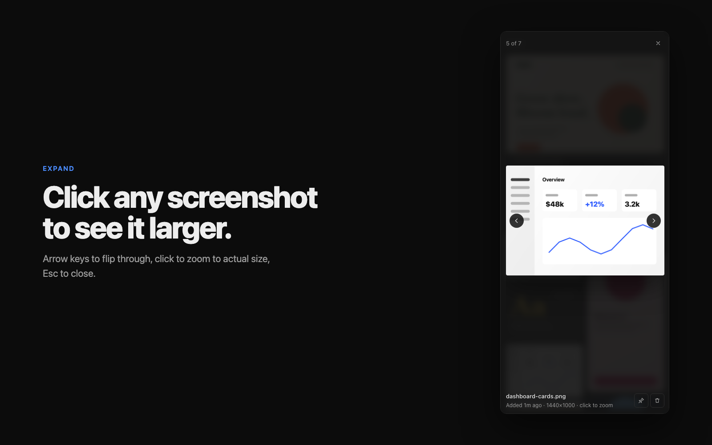

# Inspo

A right-sidebar panel for [Orca](https://www.onorca.dev) that keeps your visual references beside your work. Drag screenshots in, pin the one you're building from, and click any of them to see it larger.



## What it does

- **Drop to add.** Drag PNG, JPG, WebP or GIF files onto the panel, or use **Browse files** / the **+** button. Pasting an image (⌘V) while the panel is focused works too.
- **Board.** Screenshots show up immediately in a two-column masonry grid, newest first. It drops to one column when the sidebar is narrow.
- **Pin.** Pin one screenshot to keep it large at the top while you work. Pin another to swap it, or choose **Unpin**.
- **Expand.** Click a screenshot to open the viewer. Use the arrows or ← → to move between screenshots, click the image to zoom to actual size, and press Esc to close.
- **Remove with undo.** Removing a screenshot shows an **Undo** for a few seconds.

| Drop to add | Pin | Expand |
| --- | --- | --- |
|  |  |  |

Screenshots are kept in the panel's own storage on your machine. They stay across restarts. Uninstalling the plugin deletes them.

## Install

Find **Inspo** in Orca's plugin directory, or install it from the command line:

```sh
orca plugin install alterdianne/orca-plugin
```

Orca shows what the plugin is allowed to do and asks you to approve it before it runs.

## Permissions

None. The panel runs in Orca's sandboxed frame and asks for no capabilities. It does not read your workspace, terminals or files beyond the images you give it, and it makes no network requests.

## Develop

```sh
orca plugin validate .
orca plugin dev watch .    # loads this folder into Orca and prints its logs and reloads; Ctrl-C unloads it
```

The whole panel is `panel/index.html` (inline CSS and JS, no build step), so it runs in both Orca's desktop app and its browser clients. It uses Orca's `--orca-*` theme tokens, so it follows light and dark themes.

See Orca's [plugin authoring guide](https://github.com/stablyai/orca/blob/main/docs/reference/plugin-authoring.md).

## License

[MIT](LICENSE) © 2026 Dianne Alter
